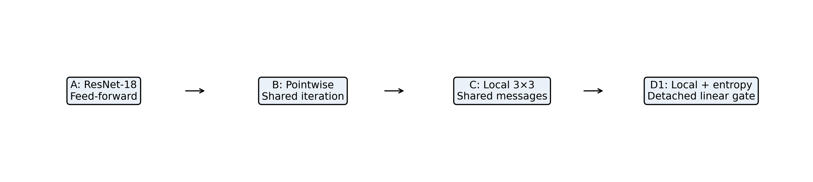

# Stability and Uncertainty in Iterative Local Communication for Visual Recognition

Reproducibility code for **“Stability and Uncertainty in Iterative Local Communication for Visual Recognition: A Controlled Study”**, by Fiseha Berhanu Tesema, University of Nottingham Ningbo China. The study separates iteration, spatial communication and uncertainty control within a CIFAR-adapted ResNet-18, and measures their accuracy, robustness and numerical stability.

## Method

| Model | Mechanism |
|---|---|
| A | Feed-forward ResNet-18 |
| B | Shared pointwise iterative refinement |
| C | Recurrent shared depthwise 3×3 local communication |
| D1 | Local communication gated by detached normalized predictive entropy |



T and residual scale λ follow the recorded configurations. D2/D3/D4 are square-root, cube-root and floor-linear gate ablations, not primary models.

## Main findings

- Pointwise recurrence underperforms A; local recurrence recovers performance relative to B.
- C-T3 is higher than one-shot C-T1 in all three matched seeds, but the paired 95% CI includes zero.
- Fixed C exhibits repeated numerical failures.
- D1 shows a positive CIFAR-10-C robustness trend, with a CI crossing zero.
- D1 does not improve CIFAR-100 accuracy.
- D1 is an adaptive communication controller, not a universally superior classifier or a guarantee of stability.

## Installation

Tested with Python 3.13.5 and PyTorch 2.9.1+cu130. Use the pinned environment:

```bash
conda env create -f environment.yml
conda activate iterative-local-communication
export CUBLAS_WORKSPACE_CONFIG=:4096:8
python -m pytest -q
```

PyTorch wheels provide runtime libraries; real experiments require a compatible NVIDIA driver and accessible GPU. CPU is sufficient for tests and synthetic smoke checks.

## Datasets

Obtain [CIFAR-10 and CIFAR-100](https://www.cs.toronto.edu/~kriz/cifar.html) through torchvision using `--download`. Obtain CIFAR-10-C from its [canonical Zenodo record](https://zenodo.org/records/2535967); the evaluator can download and checksum-verify the archive.

```text
data/
├── cifar-10-batches-py/
├── cifar-100-python/
└── CIFAR-10-C/
```

Datasets are not distributed here. Their terms are separate from the code license. [Split hashes](splits/hashes.json) record seed-specific 45,000/5,000 partitions: shuffle the 50,000 indices with a seed-specific PyTorch generator, then take the first 5,000 for validation. Hashing uses SHA-256 over Python `json.dumps(indices).encode()`.

## Reproduce

Run commands from the repository root. Omit `--execute` to inspect each matrix. Training uses the original 200 epochs, batch128, SGD lr0.1/momentum0.9/weight decay0.0005 and cosine schedule. The best validation checkpoint is selected before held-out test scoring.

```bash
# Clean CIFAR-10: A/B/C/D1
python -m scripts.run_experiment_matrix --suite cifar10 --execute --download --resume
python -m scripts.aggregate_results --suite cifar10

# CIFAR-10-C: requires the successful clean checkpoints and run summaries
python -m scripts.evaluate_cifar10c --download --checkpoints-root runs
python -m scripts.aggregate_results --suite cifar10c

# CIFAR-100
python -m scripts.run_experiment_matrix --suite cifar100 --execute --download --resume
python -m scripts.aggregate_results --suite cifar100

# Iteration depth, residual scale and gate mappings
python -m scripts.run_experiment_matrix --suite iteration_ablation --execute --download --resume
python -m scripts.run_experiment_matrix --suite communication_strength --execute --download --resume
python -m scripts.run_experiment_matrix --suite gate_ablation --execute --download --resume
python -m scripts.aggregate_results --suite iteration_ablation
python -m scripts.aggregate_results --suite communication_strength
python -m scripts.aggregate_results --suite gate_ablation
```

[configs/index.json](configs/index.json) maps exact configurations to the original training engines. Configs under `configs/ablations/` preserve the recorded values. T3 and λ1 controls reuse clean run IDs; completed and failed runs are terminal. Resume interrupted runs with the same options. New outputs remain separate from the recorded manuscript CSVs.

```bash
# Lightweight synthetic smoke check; not scientific evidence
python -m scripts.train --config configs/cifar10/cifar10-A-baseline-seed1.yaml --smoke

# Trusted checkpoints only
python -m scripts.evaluate runs/cifar10-A-baseline-seed1/best.pt
python -m scripts.analyze_refinement runs/cifar10-D1-linear-t3-seed1/best.pt --features --messages
python -m scripts.measure_efficiency --config configs/cifar10/cifar10-A-baseline-seed1.yaml
```

Refinement analysis includes corrected/damaged predictions, uncertainty quartiles and communication magnitudes. Numerical monitors and dataset-specific loaders remain in the source. No large checkpoints are included; exact captured failure-state replay needs separately archived states. Hardware differences and incompletely recorded historical TF32 settings limit bitwise reproducibility.

## Main results

Accuracy is mean ± sample SD in percent. C statistics condition on successful runs.

| Model | CIFAR-10 successes | CIFAR-10 accuracy | CIFAR-100 successes | CIFAR-100 accuracy |
|---|---:|---:|---:|---:|
| A | 5/5 | 95.202 ± 0.145 | 3/3 | 77.780 ± 0.070 |
| B | 3/3 | 94.877 ± 0.137 | — | — |
| C | 4/5 | 95.143 ± 0.095 | 1/3 | 77.340 (SD unavailable) |
| D1 | 5/5 | 95.138 ± 0.210 | 3/3 | 76.680 ± 0.606 |

CIFAR-10-C mean accuracy is 75.152% for A and 75.698% for D1; the paired D1−A difference is +0.546 pp, 95% CI [−0.564,1.656]. This is unnormalized corruption accuracy, not mCE. [Compact CSVs](results/) preserve unrounded numerical values and [metric definitions](results/README.md). Compute counts cover partial Conv2d/Linear arithmetic only; total model FLOPs are unavailable.

## Stability note

[Six recorded failures](diagnostics/failure_summary.csv) include C-T3 seed4, all three C-T5 attempts and two CIFAR-100 C seeds. Seeds were not replaced and failed runs were not assigned zero accuracy. See the [diagnostic note](diagnostics/README.md).

The [full preservation tag](https://github.com/Falmi/iterative-local-communication/tree/v1.0-full-reproducibility) and [archive branch](https://github.com/Falmi/iterative-local-communication/tree/archive/full-reproducibility) retain historical implementations, detailed diagnostics, original result records and additional figures. Main is the compact submission package; Git history has not been rewritten.

## Citation

```bibtex
@misc{tesema_iterative_local_communication,
  author = {Tesema, Fiseha Berhanu},
  title = {Stability and Uncertainty in Iterative Local Communication for Visual Recognition: A Controlled Study},
  howpublished = {Manuscript and reproducibility materials},
  url = {https://github.com/Falmi/iterative-local-communication}
}
```

See [CITATION.cff](CITATION.cff), version1.1.0. No acceptance or publication status is claimed.

## License

Code is licensed under [MIT](LICENSE). Dataset licenses apply separately.
